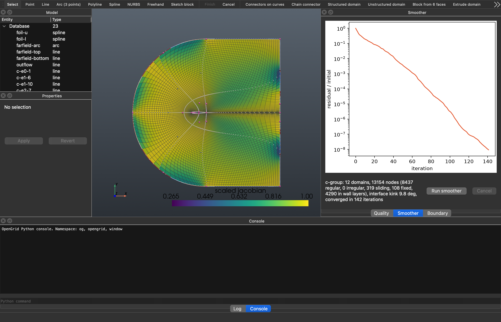

<p align="center">
  
</p>

<h1 align="center">OpenGrid</h1>

**An interactive mesh generator for CFD: structured, unstructured and hybrid meshes in 2D and 3D,
multi-block smoothing, CAD import, solver-ready export and high-order (curved)
elements for continuous and discontinuous Galerkin solvers.**

C++20 geometry and meshing core, Python bindings (nanobind), a PySide6 + VTK desktop
application, and a Python scripting API that the GUI itself uses: everything you do is an
undoable command recorded in a replayable Python journal.



<sub>NACA 0012 C-grid (12 blocks smoothed as one group, 30 wall layers from 1e-5 chords) coloured
by scaled Jacobian; the Smoother panel shows the residual history.</sub>

---

## Contents

- [Highlights](#highlights)
- [Gallery](#gallery)
- [Features](#features)
- [Quick start](#quick-start)
- [Scripting](#scripting)
- [High-order meshes](#high-order-meshes)
- [Export formats](#export-formats)
- [The desktop application](#the-desktop-application)
- [Examples](#examples)
- [Validation and testing](#validation-and-testing)
- [Performance](#performance)
- [Building from source](#building-from-source)
- [Development](#development)
- [Project layout](#project-layout)
- [Documentation](#documentation)
- [Dependencies and licences](#dependencies-and-licences)
- [Status and limitations](#status-and-limitations)

---

## Highlights

- **Every mesh type in one tool:** structured domains and blocks, unstructured triangles,
  quads, tetrahedra, prism / hexahedron boundary layers with pyramids, and hybrid models that
  mix them, conforming at their interfaces.
- **CFD-grade near-wall grids:** wall spacing control whose first-cell height and angle are
  exact at convergence, and orthogonal wall layers marched normal to the wall (0.05–0.09° mean
  deviation in every one of 30 layers from a 1e-5 first cell).
- **Multi-block smoothing groups:** many blocks smoothed as one grid, nodes
  sliding along boundaries and surfaces, singular points handled, interface kinks measured.
- **Templates and automatic topology:** O-, C-, H-grids, butterfly, body-in-channel,
  wing-in-box, sphere-in-box, pipes; cross-field-driven automatic block decomposition in 2D.
- **CAD:** STEP / IGES through OpenCASCADE, with healing and automatic connectors and domains.
- **High-order elements for CG / DG:** every cell type (triangle, quad, tetrahedron, pyramid,
  prism, hexahedron) at orders 1–6, curved onto the geometry with the boundary layer bending
  along, written to Gmsh, CGNS, VTKHDF and HDF5 with node orderings verified against each
  format's own definition.
- **Scriptable and reproducible:** one Python API for GUI and scripts, undo / redo, a journal
  that replays the session exactly, deterministic results independent of the thread count.
- **Fast:** OpenMP everywhere it matters; a 1M-cell 2D mesh in 2–5 s; Anderson-accelerated
  elliptic smoothing.

## Gallery

| | |
|---|---|
|  |  |
| **Curved high-order elements** (order 4): straight-sided faceted wall vs curved elements whose 24 boundary layers bend with the airfoil; a 1e-5 first cell under a 16-edge cylinder stays valid. | **3D smoothing groups:** sphere in a box and an O-grid ball, per-block vs smoothed as one group (min scaled Jacobian 0.58 → 0.75, interface kink 0.5°). |
|  |  |
| **3D inflation:** prism and hexahedron layers on a sphere and a wing (tetrahedra, pyramids, prisms, hexahedra), ridge fans at the trailing edge. | **CAD import (STEP):** structured and unstructured faces on the imported part, a tetrahedral solid and a fluid volume with wall layers around fillets. |
|  |  |
| **Templates and automatic topology:** O / butterfly / C / H / body-in-channel templates and cross-field block decompositions of multiply connected domains. | **Orthogonal wall layers:** wall control alone vs 30 marched wall layers at the leading and trailing edges of a C-grid. |

More pictures: [`examples/output/`](examples/output) (one figure per phase).

## Features

### Geometry
- Points, lines, circular arcs (centre / three points), polylines, cubic splines, NURBS curves
  and surfaces, revolved / extruded / ruled surfaces, curve chains.
- Airfoil `.dat` (Selig and Lednicer) and CSV point import.
- STEP / IGES import through OpenCASCADE (optional backend): sewing and healing, faces as
  surfaces, automatic connectors and structured or unstructured domains on every face.
- Extrusion of any 2D domain: a structured domain becomes a block, an unstructured one a
  volume of prisms and hexahedra (translate, rotate, normal), with the 2D patches carried
  over to the side walls and the ends patched as front / back: the one-cell-thick 3D mesh
  that 2D solvers want.
- Freehand curves drawn with the mouse, fitted to splines; a stroke released at its start is a
  closed loop, meshed with one click; curve networks with snapping. Double-click a curve to
  add a point (NURBS: by knot insertion, shape unchanged) and a handle to remove it.

### Connectors and distributions
- Uniform, geometric, tanh (Vinokur), sine distributions with begin / end spacings, growth
  ratios and breakpoints (piecewise distributions with their own spacings).
- Arc-length or parametric spacing, spacing propagation across junctions, split / join.

### 2D and surface meshing
- **Structured domains:** linear and Hermite TFI, elliptic smoothing (Laplace,
  Thomas–Middlecoff, Steger–Sorenson wall control with Hilgenstock feedback), O-grid
  (butterfly) domains, domains on surfaces.
- **Orthogonal wall layers** marched along facet-normal bisectors with a prescribed first
  height and growth, then blended into the smoothed grid.
- **Unstructured domains:** constrained Delaunay with refinement (Shewchuk's robust
  predicates), advancing front with size fields and sources, quad-dominant and all-quad
  recombination, smoothing and edge swapping.
- **2D inflation layers** (quads in a triangle or quad core) with first height, growth and
  layer count, smoothed normals, fans at sharp corners and trailing edges, and termination where
  layers would cross or come too close.

### 3D meshing
- **Structured blocks** from six faces, extrusion, revolution, hyperbolic extrusion; 3D
  elliptic smoothing with surface-constrained boundaries.
- **Unstructured volumes:** Netgen tetrahedra; pyramids on quad faces; prism and hexahedron
  boundary layers with sliding on planar faces, ridge fans and corner caps; an own optimiser
  (smoothing, swaps) and a quality floor every cell must meet.
- **Mixed models:** blocks and volumes in one model, conforming through shared faces.

### Multi-block topology
- Split and join domains and blocks, O-grid (butterfly) conversion, block faces from domains.
- **Smoothing groups (2D and 3D):** elliptic smoothing across block interfaces as if the
  blocks were one grid; boundary nodes sliding on their curves and surfaces; singular points
  (3 or 5 blocks around a vertex); symmetry planes; wall control and wall layers; Anderson
  acceleration with a safeguard.
- **Sketch topology:** draw a block layout with the mouse (edges drawn onto existing
  connectors adopt them and share their nodes; any block can be meshed unstructured, with
  the walls on it as inflation layers); it is fitted to the geometry and
  meshed. Live editing: drag control points and vertices with immediate previews.
- **Templates:** 2D `ogrid`, `butterfly`, `cgrid`, `hgrid`, `body_in_channel` (also
  extruded); 3D `pipe`, `cylinder_in_channel`, `bump_channel`, `wing_in_box` (taper, sweep,
  symmetry planes), `sphere_in_box`.
- **Automatic topology (2D):** a cross field computed on the domain, its singularities and
  separatrices traced into a block decomposition.

### Boundary conditions
- **Patches** (wall, inlet, outlet, symmetry, farfield, periodic, interface, user) and **zones**,
  validated before export: every boundary in exactly one patch, interfaces detected
  automatically, clear messages naming the entity and what is wrong.
- **Periodic pairs** (translational and rotational, about any axis) of 2D connectors and 3D
  faces (block faces, volume faces, the ends and side walls of extruded volumes), matched node
  by node and written as periodic connectivity (CGNS 2D: translational); two selected sides
  pair in one step.
- **2D model extruded one cell thick** (`extrude_model`): blocks and volumes with the 2D
  patches on their sides and the front / back as a periodic pair or symmetry planes, for
  solvers that want 3D meshes of 2D cases.
- **Surface meshes of 3D shapes** (Create > Mesh surfaces, `mesh_surfaces`): domains on
  planes, ruled, extruded and revolved surfaces with their edge curves found or made and the
  connectors shared, a watertight shell for Volume from faces (a cylinder, a sphere or a wing
  in a box; poles are meshed as fans).
- **Picking through surfaces and hiding**: a click picks lines and points before surfaces,
  so a body inside its far-field box is selected directly; View > Hide selected (H) takes
  entities out of the view and out of picking, Shift+H shows all.
- **Standard shapes** (Create > Shapes, `create_airfoil`, `create_rectangle`,
  `create_ellipse`, `create_box`, `create_cylinder`, `create_sphere`, `create_wing`): NACA
  4-digit airfoils, exact ellipses, boxes, cylinders and spheres of revolution, tapered
  swept wings; each one undo step with named parts.
- **Drag the geometry with the mesh in place**: a selected domain, connector or sketch
  block shows the handles of what moves it (its curves' points, or the sketch's vertices);
  dragging one regenerates and remeshes, layers included.
- **Boundary panel** that follows the model: every boundary with its patch, type and status,
  the periodic pairs with their transform and whether their nodes match (and why not, in
  plain words), the interfaces found automatically; Set type, Pair as periodic and Clear
  type act on the selection; one status line says whether the boundary is ready to export.
  With the reference grid shown, 2D clicks snap to its minor lines, so drawn sides are
  exact.

### Quality
- Scaled Jacobian, equiangle skewness, aspect ratio, minimum / maximum included angle,
  non-orthogonality, neighbour area / volume ratio and cell volume, for every cell type; colour
  maps in the GUI, a worst-cell finder, and a quality floor for 3D cells.

### High-order elements
See [High-order meshes](#high-order-meshes).

### GPU (experimental)
- An OpenCL backend for the 3D group smoother's line sweeps (float-float positions), with
  device detection, a self-test and an `auto` mode. Off by default: measured faster per
  sweep, not to the same accuracy (see `docs/PROGRESS.md`, Phase 11d).

## Quick start

```bash
git clone https://github.com/jcatalang/OpenGrid.git
cd OpenGrid
conda env create -f environment.yml        # conda-forge: Qt, VTK, CGNS, HDF5, Netgen, OCCT, Eigen ...
conda activate opengrid
pip install --no-build-isolation -e .      # builds the C++ core and the Python extension
python -m opengrid                          # the desktop application
python -m opengrid examples/output/04_airfoil_cgrid.ogp   # ... with a project
```

On macOS, `packaging/macos/install_launcher.sh` installs **OpenGrid.app** in `/Applications`:
a launcher of this environment (always the current code), with the OpenGrid icon, that opens
`.ogp` projects double-clicked in the Finder.

## Scripting

The GUI and scripts share one API (`opengrid.Session`); the GUI's Python console exposes the
open model as `og`.

**An O-grid around a cylinder, ready for a solver:**

```python
import opengrid

og = opengrid.Session()
og.create_circle((0, 0), 0.5, name="cylinder")
og.create_circle((0, 0), 10.0, name="far")
og.create_line((0.5, 0), (10, 0), name="cut")
og.create_connector("cylinder", 129, name="c-cyl")
og.create_connector("far", 129, name="c-far")
og.create_connector(
    "cut", 81, {"type": "tanh", "begin_spacing": 1e-4, "end_spacing": 1.0}, name="c-cut"
)
og.create_domain([[("c-cyl", True)], ["c-cut"], ["c-far"], [("c-cut", True)]], name="ogrid")
og.create_patch("wall", "wall", ["c-cyl"])
og.create_patch("farfield", "farfield", ["c-far"])
og.export_cgns("cylinder.cgns")
og.export_high_order("cylinder_p4.msh", order=4)  # curved order-4 quadrilaterals for DG
print(og.journal_text())  # replayable script of everything done
```

**A C-grid template with orthogonal wall layers, smoothed as one group:**

```python
og = opengrid.Session()
body = og.import_airfoil_dat("naca0012.dat", name="naca", mode="split")  # any Selig / Lednicer file
og.create_template("cgrid", body=body, wall=1e-5, layers=24, name="c")
og.smooth_group("c-group")
print(min(q["scaled_jacobian"].min() for q in map(og.domain_quality, og.names("domain"))))
```

The full guide is [`docs/SCRIPTING.md`](docs/SCRIPTING.md); every public method is listed in
[`docs/API.md`](docs/API.md) (generated from the docstrings).

## High-order meshes

OpenGrid writes the high-order meshes that continuous and discontinuous Galerkin, spectral
element and flux-reconstruction solvers read:

- **Every cell type:** lines, triangles, quadrilaterals, tetrahedra, pyramids, prisms and
  hexahedra, orders 1–6 (CGNS defines up to 4). Each cell of the mesh becomes one element;
  shared edge and face nodes are merged exactly (integer keys, no tolerances); patches get
  boundary elements of the same order; periodic links carry over to the high-order nodes.
- **Curved boundaries (default):** boundary nodes are moved onto the true geometry — the
  connectors' curves, the faces' surfaces (including CAD NURBS faces), or the interpolation of
  a face's own grid — and the displacement is carried into the mesh by a stiffened graph
  Laplacian (Eigen sparse Cholesky / preconditioned CG), so boundary-layer stacks bend with
  the wall instead of folding. Every changed element's Jacobian is checked; folded elements
  are reported, never silently written. `curved=False` gives straight-sided elements.
- **Accuracy:** on a circle the element edges converge at h^(p+1) (h^(p+2) for even p) where
  straight sides stay at h^2; airfoil wall nodes land on the spline to 3e-17, CAD faces to 7e-16.
- **Verified node orderings:** generated from one table per format and checked against Gmsh's
  own element definitions (orders 1–6), VTK's Lagrange cells (live) and CGNS (Gmsh's CGNS
  writer plus every node description in the CGNS SIDS); exported files are read back by Gmsh
  and `cgnscheck` and every element is re-evaluated.
- **Node sets:** equispaced (the file formats' definition) and, in HDF5, Gauss–Lobatto–Legendre
  and Gauss–Legendre points for quadrilaterals and hexahedra.
- **Curved structured elements:** `curved_high_order` agglomerates p × p (× p) grid cells of
  structured domains / blocks into one element, so the smoothed grid places every node.

```python
mesh = og.high_order(order=4)  # an ElementMesh
print(mesh.counts(), mesh.curving)  # elements per kind; moved nodes, quality curved vs straight
conn = mesh.connectivity("quad", "cgns")  # any kind, in any format's node order
og.export_high_order("case_p4.cgns", order=4)
og.export_high_order("case_p4_gll.h5", order=4, nodes="gll")
```

## Export formats

| Format | Content |
|---|---|
| **CGNS** (`.cgns`) | structured, unstructured and mixed zones; families, BCs per patch, 1-to-1 and general connectivity, periodicity; high-order SIDS element types up to order 4 |
| **Gmsh 4.1** (`.msh`) | physical groups per zone and patch, periodic links; high-order element types up to order 6 |
| **VTKHDF** (`.vtkhdf`) | unstructured grids or partitioned collections (zones, patches), quality fields; VTK Lagrange cells |
| **Plot3D** (`.xyz`) | multi-block structured grids, 2D or 3D |
| **HDF5** (`.h5`) | high-order element node coordinates in a chosen node set |
| **Project** (`.ogp`) | JSON project with the full model and the replayable journal |

All writers are OpenGrid's own (the Gmsh library is not linked); files are validated against
the reference readers (VTK, Gmsh, meshio, `cgnscheck`) in the tests.

## The desktop application

- Model tree, property panel, quality / smoother / boundary panels, log, Python console.
- Drawing tools for geometry, connectors, freehand curves and sketch blocks (toolbar icons,
  keys `S P L A W B N D K`); snapping; live drag previews of handles; double-click adds or
  removes curve points.
- Colour by quality, patches or entities; node display; block cuts and shrunk cells for 3D.
- **Navigation.** 2D: left-drag (or a three-finger drag on a trackpad) zooms to a window
  drawn live, or pans (View menu); Shift + drag or middle-drag pans; wheel / two-finger scroll
  and right-drag zoom. 3D (switched on when the model gains blocks, volumes or surfaces, or
  by hand): left-drag rotates, Shift + drag pans, Alt + drag zooms to a window. `F` re-centres
  the view keeping its direction, `Z` zooms to the selection, `1 2 3` look at the XY, XZ and
  YZ planes (again: from the other side), `7` is the isometric view, `V` toggles perspective,
  `Esc` cancels, `G` shows a reference grid whose step follows the zoom: the plane facing an
  axis view with the coordinates along the edges, or the three axis planes with the
  coordinates along the axes in a tilted view. The keys work wherever the focus is, except in
  text fields.
- Selection by click in any view (3D picks along the view ray), hover highlight, the
  pointer's coordinates in the status bar, and a right-click menu with what applies to the
  selection, including "Boundary type" (the selection joins a wall, inlet, outlet, symmetry,
  farfield, periodic, interface or user patch) and domain conversion.
- The property panel suggests values: clustering spacings when a distribution type is
  chosen (a quarter of the uniform spacing at the clustered ends, growth 1.2), the first
  layer height of inflation layers (a twentieth of the boundary spacing, used when the field
  is left empty), and a connector's boundary type.
- Long operations (volume meshing, templates, CAD import, high-order elements, exports) run in
  a worker thread behind a busy dialog; the window keeps repainting.
- Undo / redo of every action (an edit plus a rename in the property panel is one step; Enter
  applies); projects save the model with its journal; window layout, view options, recent
  files and the last directory persist between runs.
- The window title shows the commit the application runs, and the status bar says when the
  code was updated while it runs.

## Examples

One demo per phase in [`examples/`](examples), each writing its figures and reports to
`examples/output/`:

| Script | What it shows |
|---|---|
| `01_geometry.py`, `02_connectors.py` | geometry kernel, project I/O, distributions |
| `03_airfoil_grids.py`, `03_backward_step.py` | structured O / C grids with wall control, multi-block step |
| `04_solver_ready.py` | patches, zones, CGNS / Gmsh / VTKHDF export with read-back |
| `05a_unstructured.py` … `05c_quads.py` | Delaunay, advancing front, quad-dominant meshes |
| `06_inflation.py` | 2D boundary layers |
| `07a_blocks.py`, `07b_smoothing.py` | 3D blocks, 3D elliptic smoothing, hyperbolic extrusion |
| `08a_volumes.py` … `08c_optimisation_mixed.py` | tetrahedral volumes, 3D layers, optimiser, mixed models |
| `09a_cad_import.py` | STEP / IGES import and meshing |
| `09b_topology_golden.py` | topology editing and the golden validation cases |
| `09c_performance.py`, `11b_performance.py` | benchmarks |
| `10a_multiblock_smoothing.py`, `10b_multiblock_3d.py` | smoothing groups in 2D and 3D |
| `10c_freehand_live.py`, `10d_sketch_topology.py` | live editing, freehand curves, sketch topology |
| `10e_templates_auto.py` | templates and automatic topology |
| `11a_wall_layers.py` | orthogonal wall layers |
| `11d_gpu.py` | experimental GPU smoothing |
| `11e_high_order.py`, `11f_high_order_elements.py`, `11g_curved_elements.py` | high-order meshes |

`examples/golden/` holds ten validation cases (unit square, quarter annulus, NACA 0012 grids,
cylinder O-grid, backward step, hybrid airfoil, duct, annular sector, sphere in a box, wing
stub) with reference metrics checked by the tests.

## Validation and testing

- **154 C++ tests** (GoogleTest) and **416 Python tests** (pytest, including offscreen GUI tests
  with pytest-qt) cover the geometry kernel, distributions, every mesher, smoothing, quality,
  topology editing, exports read back by their reference readers, journal replay, determinism
  across thread counts and the golden cases.
- High-order node orderings are tested against reference data from Gmsh, against VTK's
  Lagrange cells and against the CGNS SIDS; curved meshes against convergence rates and
  element validity.
- Strict CI preset (warnings as errors), clang-tidy, clang-format, ruff, and a custom check
  that forbids inline ternaries (project convention).

```bash
ctest --preset release
pytest -q
```

## Performance

Apple M1 Max, 10 threads (from `examples/09c_performance.py` and `examples/11b_performance.py`):

| Case | Size | Time |
|---|---|---|
| 2D structured TFI (grid + quality + VTKHDF) | 1.0 M cells | 1.8 s |
| 2D constrained Delaunay | 1.23 M cells | 3.4 s |
| 2D advancing front | 1.25 M cells | 4.1 s |
| 2D hybrid (layers + triangles) | 1.54 M cells | 4.9 s |
| Elliptic smoothing with wall control | 500 × 200 | 0.68 s |
| 3D elliptic block | 81 × 41 × 41 | 0.58 s |
| 3D smoothing group, wing stub | 12 blocks | 9.2 s |
| 3D smoothing group, ball | 1 M cells | 22 s |
| High-order curving, O-grid ball, order 4 | 32 k hexahedra, 2 M nodes | 10 s |

Results are bit-identical for any thread count (`opengrid.set_threads(n)`).

## Building from source

### conda-forge (recommended)
```bash
conda env create -f environment.yml
conda activate opengrid
pip install --no-build-isolation -e .   # rerun after C++ changes
```

### C++ only
```bash
cmake --preset release && cmake --build --preset release && ctest --preset release
```

### macOS compiler note
Apple Clang ≥ 15 is required. If `clang++ --version` is older because `xcode-select` points to
an old Xcode, set it for the environment only:
```bash
conda env config vars set DEVELOPER_DIR=/Library/Developer/CommandLineTools -n opengrid
conda deactivate && conda activate opengrid
```

### uv (alternative)
Needs CMake ≥ 3.28, Ninja, a C++20 compiler, Eigen, HDF5 and CGNS from the system (Homebrew:
`brew install cmake ninja googletest eigen hdf5 cgns`; Ubuntu: `apt install cmake ninja-build
libgtest-dev libeigen3-dev libhdf5-dev libcgns-dev`):
```bash
uv venv --python 3.12 && source .venv/bin/activate
uv pip install scikit-build-core nanobind
uv pip install --no-build-isolation -e ".[gui,test]"
```

### Packages
- **conda package:** `rattler-build build --recipe packaging/conda/recipe.yaml -m
  packaging/conda/variants.yaml -c conda-forge --output-dir packaging/output`.
- **Self-contained macOS app + DMG:** `packaging/macos/build_app.sh` (conda-pack; ad-hoc
  signed).
- **Development launcher app (macOS):** `packaging/macos/install_launcher.sh`;
  `python tools/check_launcher.py` says whether the installed one is current.

## Development

```bash
pytest -q                                   # Python and GUI tests (offscreen)
ruff check . && ruff format --check .
clang-format --dry-run --Werror $(git ls-files '*.cpp' '*.hpp' '*.h')
python tools/check_no_ternary.py
python tools/gen_api_docs.py                # after changing public Session methods
```

Conventions (details in `CLAUDE.md` and `docs/ARCHITECTURE.md`):
- Algorithms in C++ (`og_core`, no Python / Qt / VTK dependency); the entity store, commands
  and exporters in Python.
- Every model change is a command (undo / redo + journal); there is no other mutation path.
- One algorithm per file, with a header comment giving the method and its reference.
- Validators report (entity, index, what is wrong) and never fix input silently.
- Determinism: fixed seeds, stable ordering, thread-independent reductions.
- No inline ternaries in C++ or Python.

## Project layout

```
core/                 C++20 core library og_core
  include/opengrid/core/   geom, dist, topo, structured, unstructured, quality, highorder, gpu, io, util
  src/                     implementations (one algorithm per file)
  tests/                   GoogleTest
bindings/             nanobind module opengrid._core
backends/occt/        optional OpenCASCADE backend (opengrid._occt)
python/opengrid/
  api.py              the Session API
  model/              entity store, evaluators, groups, templates, high-order elements, curving
  commands/           undoable commands and the journal
  io/                 exporters and importers (CGNS, Gmsh, VTKHDF, Plot3D, Lagrange node orders)
  app/                the PySide6 application
examples/             one demo per phase, golden cases, output/
tests/python/         pytest suite (with reference data in data/)
packaging/            conda recipe, macOS app bundle and launcher
docs/                 specification, architecture, roadmap, progress, open issues, API
tools/                API docs generator, checks, GPU studies
```

## Documentation

- [`docs/SCRIPTING.md`](docs/SCRIPTING.md) — scripting guide
- [`docs/API.md`](docs/API.md) — API reference (generated)
- [`docs/ARCHITECTURE.md`](docs/ARCHITECTURE.md) — design decisions, algorithms, licensing
- [`docs/ROADMAP.md`](docs/ROADMAP.md) — phases and acceptance criteria
- [`docs/PROGRESS.md`](docs/PROGRESS.md) — what was built, measured and verified, phase by phase
- [`docs/OPEN_ISSUES.md`](docs/OPEN_ISSUES.md) — known limitations and caveats
- [`docs/SPEC.md`](docs/SPEC.md) — the original requirements

## Dependencies and licences

| Component | Use | Licence |
|---|---|---|
| Eigen | sparse linear algebra (curving) | MPL-2.0 |
| nanobind | Python bindings | BSD-3 |
| HDF5, CGNS | VTKHDF / CGNS writing | BSD-style, zlib |
| Shewchuk's robust predicates | geometric predicates | public domain |
| PySide6 / Qt 6 | GUI | LGPL-3.0 (dynamic) |
| VTK, pyvista, pyvistaqt | rendering, picking | BSD-3, MIT |
| Netgen | tetrahedral volume meshing | LGPL-2.1 (dynamic, optional) |
| OpenCASCADE | STEP / IGES import | LGPL-2.1 with exception (dynamic, optional) |
| OpenMP runtime | parallel loops | Apache-2.0 with LLVM exception |
| NumPy, h5py, meshio | arrays, HDF5, test read-back | BSD-3, BSD-3, MIT |

Deliberately not used: TetGen (AGPL), Triangle (non-free), GPL parts of CGAL and the Gmsh
library (GPL); Gmsh's `.msh` format is written by OpenGrid's own code. Full table:
[`docs/ARCHITECTURE.md`](docs/ARCHITECTURE.md#2-dependencies-and-licenses).

## Status and limitations

All planned phases (0–11g) are complete and tested on macOS (Apple silicon). The conda
environment and a GitHub Actions workflow for macOS and Linux are set up, but Linux has not
been built yet. Known limitations —
for example, curved high-order elements are not untangled when they fold, 3D automatic
topology is not available, Netgen dominates very large tetrahedral meshes, and the GPU path is
experimental — are collected in [`docs/OPEN_ISSUES.md`](docs/OPEN_ISSUES.md).

## Licence

No licence has been chosen yet; the repository is private and all rights are reserved by the
author. Third-party components keep their own licences (above).
