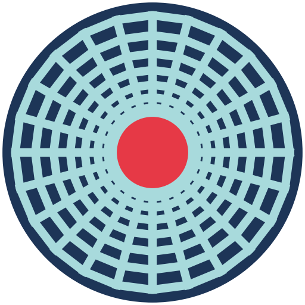
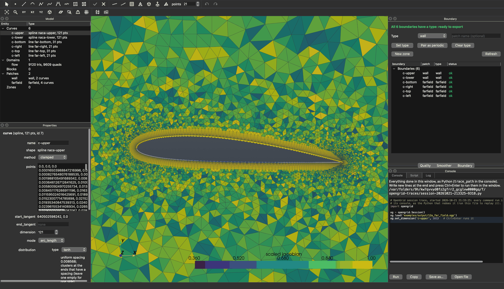
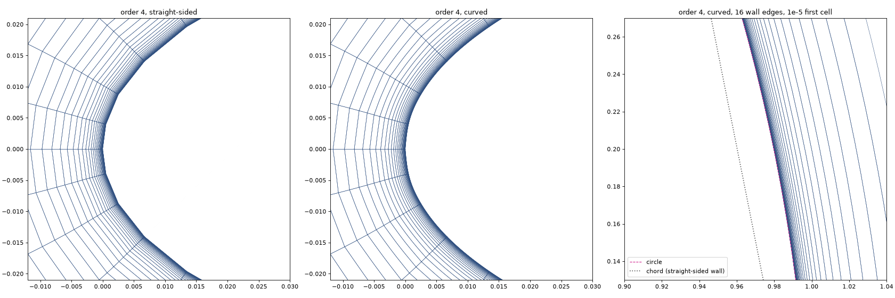
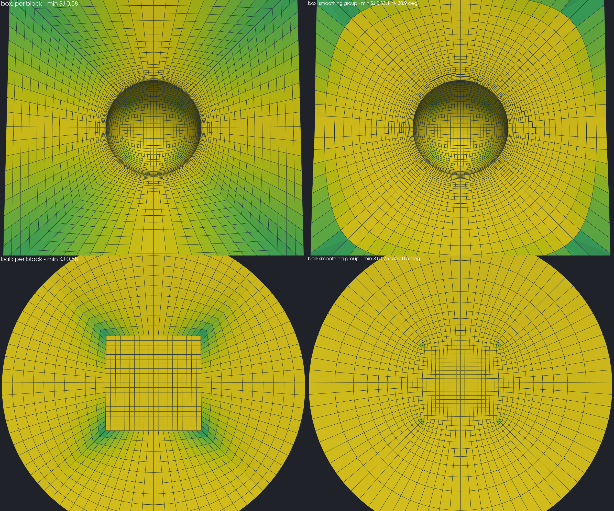
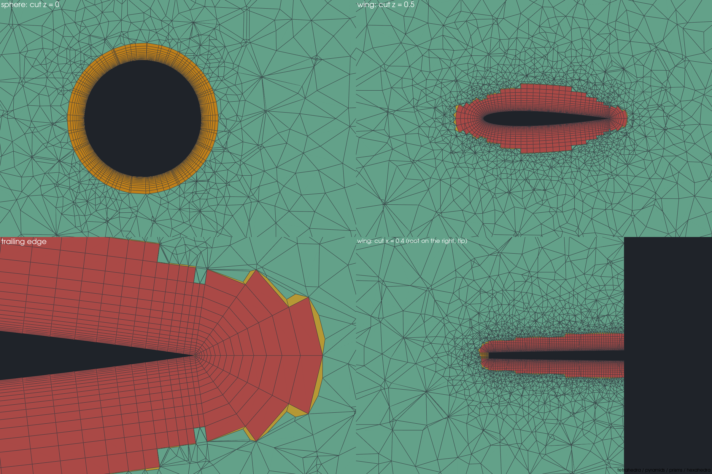
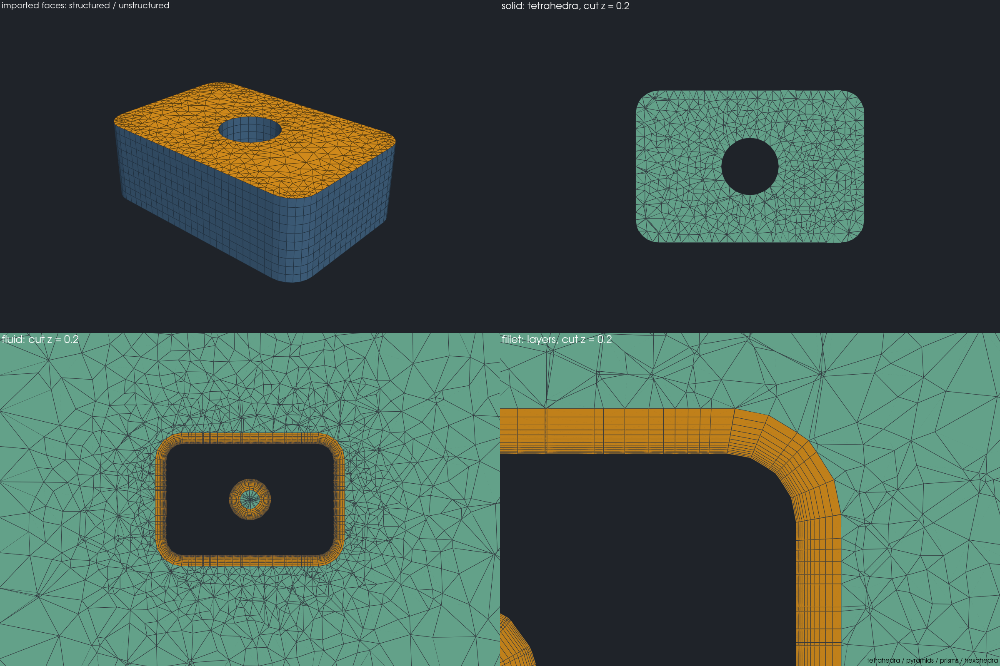
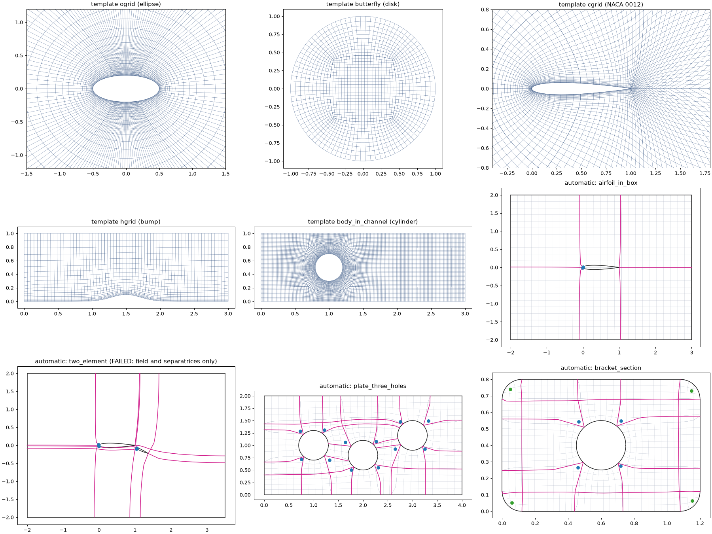
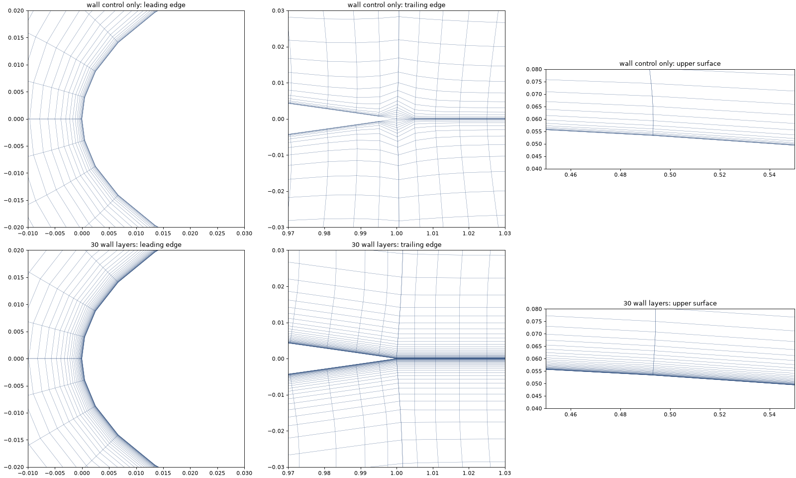
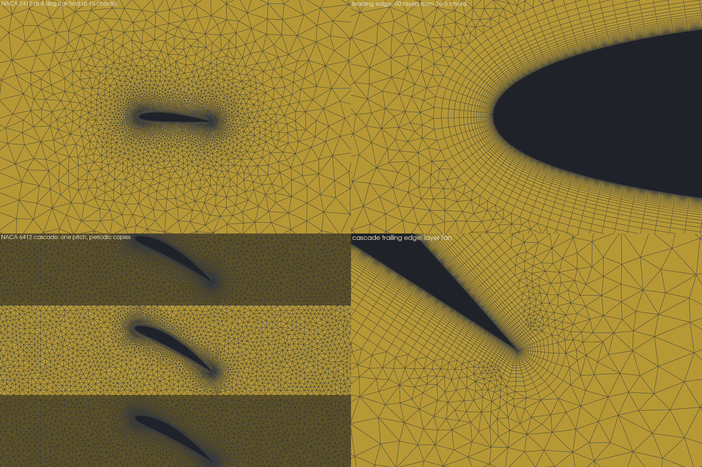
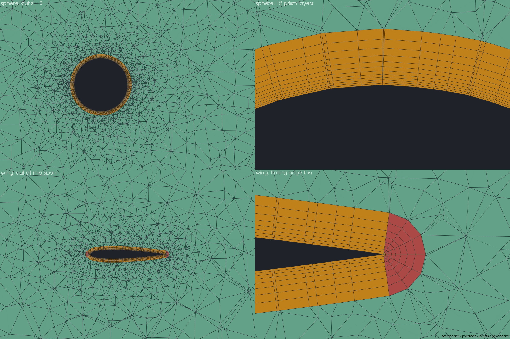

<p align="center">
  
</p>

<h1 align="center">OpenGrid</h1>

**An interactive mesh generator for CFD: structured, unstructured and hybrid meshes in 2D and 3D,
multi-block smoothing, CAD import, solver-ready export and high-order (curved)
elements for continuous and discontinuous Galerkin solvers.**

C++20 geometry and meshing core, Python bindings (nanobind), a PySide6 + VTK desktop
application, and a Python scripting API that the GUI itself uses: everything you do is an
undoable command recorded in a replayable Python journal.



<sub>A NACA 2412 in a far field (example 12a: 40 inflation layers from 2e-5 chord, triangles
outside) coloured by scaled Jacobian. Left: the curves with their points and the selected
curve's shape and distribution; right: the Boundary panel (every boundary typed, ready to
export) and the Script tab, where everything done in the window appears as Python and new
lines run with Ctrl+Enter.</sub>

---

## Contents

- [Highlights](#highlights)
- [Gallery](#gallery)
- [Features](#features)
- [Quick start](#quick-start)
- [Scripting](#scripting)
- [High-order meshes](#high-order-meshes)
- [Export formats](#export-formats)
- [The desktop application](#the-desktop-application)
- [Examples](#examples)
- [Validation and testing](#validation-and-testing)
- [Performance](#performance)
- [Building from source](#building-from-source)
- [Development](#development)
- [Project layout](#project-layout)
- [Documentation](#documentation)
- [Dependencies and licences](#dependencies-and-licences)
- [Status and limitations](#status-and-limitations)

---

## Highlights

- **Every mesh type in one tool:** structured domains and blocks, unstructured triangles,
  quads, tetrahedra, prism / hexahedron boundary layers with pyramids, and hybrid models that
  mix them, conforming at their interfaces.
- **CFD-grade near-wall grids:** wall spacing control whose first-cell height and angle are
  exact at convergence, and orthogonal wall layers marched normal to the wall (0.05–0.09° mean
  deviation in every one of 30 layers from a 1e-5 first cell).
- **Multi-block smoothing groups:** many blocks smoothed as one grid, nodes
  sliding along boundaries and surfaces, singular points handled, interface kinks measured.
- **Templates and automatic topology:** O-, C-, H-grids, butterfly, body-in-channel,
  wing-in-box, sphere-in-box, pipes; cross-field-driven automatic block decomposition in 2D.
- **CAD:** STEP / IGES through OpenCASCADE, with healing and automatic connectors and domains.
- **High-order elements for CG / DG:** every cell type (triangle, quad, tetrahedron, pyramid,
  prism, hexahedron) at orders 1–6, curved onto the geometry with the boundary layer bending
  along, written to Gmsh, CGNS, VTKHDF and HDF5 with node orderings verified against each
  format's own definition.
- **From a shape to a solver-ready case in a few lines:** NACA airfoils, ellipses, boxes,
  cylinders, spheres and swept wings as closed bodies; surface meshes on them with shared
  edges, volumes with boundary layers, boundary types and periodic pairs in one call each.
- **Scriptable and reproducible:** one Python API for GUI and scripts, undo / redo, a journal
  that replays the session exactly, deterministic results independent of the thread count.
  In the application, an IPython console and a Script tab that shows everything done in the
  window as Python and runs the lines you add.
- **Fast:** OpenMP everywhere it matters; a 1M-cell 2D mesh in 2–5 s; Anderson-accelerated
  elliptic smoothing.

## Gallery

| | |
|---|---|
|  |  |
| **Curved high-order elements** (order 4): straight-sided faceted wall vs curved elements whose 24 boundary layers bend with the airfoil; a 1e-5 first cell under a 16-edge cylinder stays valid. | **3D smoothing groups:** sphere in a box and an O-grid ball, per-block vs smoothed as one group (min scaled Jacobian 0.58 → 0.75, interface kink 0.5°). |
|  |  |
| **3D inflation:** prism and hexahedron layers on a sphere and a wing (tetrahedra, pyramids, prisms, hexahedra), ridge fans at the trailing edge. | **CAD import (STEP):** structured and unstructured faces on the imported part, a tetrahedral solid and a fluid volume with wall layers around fillets. |
|  |  |
| **Templates and automatic topology:** O / butterfly / C / H / body-in-channel templates and cross-field block decompositions of multiply connected domains. | **Orthogonal wall layers:** wall control alone vs 30 marched wall layers at the leading and trailing edges of a C-grid. |
|  |  |
| **From the standard shapes (2D):** a NACA 2412 in a far field and a periodic NACA 6412 cascade, 40 inflation layers from 2e-5 chord, the cascade's neighbours drawn to show the matching periodic nodes. | **From the standard shapes (3D):** a sphere and a closed swept wing in boxes, prism layers grown off the surface meshes, the trailing-edge fan in hexahedra. |

More pictures: [`examples/output/`](examples/output) (one figure per example).

## Features

### Geometry
- Points, lines, circular arcs (centre / three points), polylines, cubic splines, NURBS curves
  and surfaces, revolved / extruded / ruled surfaces, curve chains.
- **Standard shapes**, each a closed body made in one undo step with named parts: NACA
  4-digit airfoils (chord, angle of attack, cosine-spaced points, sharp trailing edge),
  rectangles, circles, exact ellipses, boxes, cylinders and spheres (as two halves, so they
  can be surface-meshed) and tapered, swept wings with root and tip caps.
- Airfoil `.dat` (Selig and Lednicer) and CSV point import.
- STEP / IGES import through OpenCASCADE (optional backend): sewing and healing, faces as
  surfaces, automatic connectors and structured or unstructured domains on every face.
- Freehand curves drawn with the mouse, fitted to splines; a stroke released at its start is a
  closed loop, meshed with one click; curve networks with snapping. Double-click a curve to
  add a point (NURBS: by knot insertion, shape unchanged) and a handle to remove it; a closed
  curve's seam moves as one point.

### Curves, their points and distributions
- A curve is its shape (a line, arc, spline, ...) and its points; the application shows them
  as one item, the API as a database curve and a connector on it. `preview_points` (pink
  dots in the window) shows where points would land before anything is meshed or applied.
- Uniform, geometric, tanh (Vinokur), sine distributions with begin / end spacings, growth
  ratios and breakpoints (piecewise distributions with their own spacings).
- Arc-length or parametric spacing, spacing propagation across junctions, split / join.
- Changing a connector's points changes the connectors opposite to it in every structured
  domain it belongs to (and so across blocks), so the topology stays valid; a sketch's
  connector sets its whole edge family.

### 2D and surface meshing
- **Structured domains:** linear and Hermite TFI, elliptic smoothing (Laplace,
  Thomas–Middlecoff, Steger–Sorenson wall control with Hilgenstock feedback), O-grid
  (butterfly) domains, domains on surfaces.
- **Orthogonal wall layers** marched along facet-normal bisectors with a prescribed first
  height and growth, then blended into the smoothed grid.
- **Unstructured domains:** constrained Delaunay with refinement (Shewchuk's robust
  predicates), advancing front with size fields and sources, quad-dominant and all-quad
  recombination, smoothing and edge swapping.
- **2D inflation layers** (quads in a triangle or quad core) with first height, growth and
  layer count, smoothed normals, fans at sharp corners and trailing edges, and termination where
  layers would cross or come too close. The first height is suggested from the boundary
  spacing when left empty.
- **Regions between curves:** select an outer boundary and the bodies inside it, and one
  domain meshes the space between them (the bodies are holes).
- **Surface meshes of 3D shapes** (`mesh_surfaces`): an unstructured domain on each plane,
  ruled, extruded or revolved surface, its edge curves found or made and the connectors
  shared with the neighbouring surfaces, so a closed set of surfaces is a watertight shell.
  Surfaces of revolution that close at a pole (a sphere) are meshed in a conformal map, so the
  triangles keep their shape at the poles.

### 3D meshing
- **Structured blocks** from six faces, extrusion, revolution, hyperbolic extrusion; 3D
  elliptic smoothing with surface-constrained boundaries.
- **Unstructured volumes:** Netgen tetrahedra; pyramids on quad faces; prism and hexahedron
  boundary layers with sliding on planar faces, ridge fans and corner caps; an own optimiser
  (smoothing, swaps) and a quality floor every cell must meet.
- **Mixed models:** blocks and volumes in one model, conforming through shared faces.
- **Extrusion of any 2D domain or of the whole 2D model:** structured domains become blocks,
  unstructured ones volumes of prisms and hexahedra, the 2D patches carried over to the side
  walls; `extrude_model` makes the one-cell-thick 3D mesh of a 2D case with front and back as
  a periodic pair or symmetry planes.

### Multi-block topology
- Split and join domains and blocks, O-grid (butterfly) conversion, block faces from domains,
  structured ↔ unstructured conversion of a domain on the same connectors (a sketch's domain
  through its sketch).
- **Smoothing groups (2D and 3D):** elliptic smoothing across block interfaces as if the
  blocks were one grid; boundary nodes sliding on their curves and surfaces; singular points
  (3 or 5 blocks around a vertex); symmetry planes; wall control and wall layers; Anderson
  acceleration with a safeguard.
- **Sketch topology:** draw a block layout with the mouse (blocks drawn onto a sketch's
  vertices join it; edges drawn onto existing connectors adopt them and share their nodes;
  any block can be meshed unstructured, with the walls on it as inflation layers); it is
  fitted to the geometry and meshed. Deleting a block's domain removes the block. Live
  editing: drag control points and vertices with immediate previews and remeshing.
- **Templates:** 2D `ogrid`, `butterfly`, `cgrid`, `hgrid`, `body_in_channel` (also
  extruded); 3D `pipe`, `cylinder_in_channel`, `bump_channel`, `wing_in_box` (taper, sweep,
  symmetry planes), `sphere_in_box`.
- **Automatic topology (2D):** a cross field computed on the domain, its singularities and
  separatrices traced into a block decomposition.

### Boundary conditions
- **Patches** (wall, inlet, outlet, symmetry, farfield, periodic, interface, user) and **zones**,
  validated before export: every boundary in exactly one patch, interfaces detected
  automatically (a connector shared by two domains takes no type), clear messages naming the
  entity and what is wrong. `set_boundary_type` puts a selection into a patch of a type in
  one step.
- **Periodic pairs** (translational and rotational, about any axis) of 2D connectors and 3D
  faces (block faces, volume faces, the ends and side walls of extruded volumes), matched node
  by node and written as periodic connectivity (CGNS 2D: translational). `make_periodic_pair`
  makes and pairs both sides in one step; when the nodes do not match, the report says why
  (point counts, a transform that misses, different distributions). In the application the
  faces of blocks and volumes are picked with a click and typed or paired from the panels.

### Quality
- Scaled Jacobian, equiangle skewness, aspect ratio, minimum / maximum included angle,
  non-orthogonality, neighbour area / volume ratio and cell volume, for every cell type; colour
  maps in the GUI, a worst-cell finder, and a quality floor for 3D cells.

### High-order elements
See [High-order meshes](#high-order-meshes).

### GPU (experimental)
- An OpenCL backend for the 3D group smoother's line sweeps (float-float positions), with
  device detection, a self-test and an `auto` mode. Off by default: measured faster per
  sweep, not to the same accuracy (see `docs/PROGRESS.md`, Phase 11d).

## Quick start

```bash
git clone https://github.com/jcatalang/OpenGrid.git
cd OpenGrid
conda env create -f environment.yml        # conda-forge: Qt, VTK, CGNS, HDF5, Netgen, OCCT, Eigen ...
conda activate opengrid
pip install --no-build-isolation -e .      # builds the C++ core and the Python extension
python -m opengrid                          # the desktop application
python -m opengrid examples/output/04_airfoil_cgrid.ogp   # ... with a project
```

On macOS, `packaging/macos/install_launcher.sh` installs **OpenGrid.app** in `/Applications`:
a launcher of this environment (always the current code), with the OpenGrid icon, that opens
`.ogp` projects double-clicked in the Finder.

## Scripting

The GUI and scripts share one API (`opengrid.Session`); the GUI's IPython console exposes
the open model as `og`, and its Script tab shows everything done in the window as the
`Session` calls that redo it (a replayable script, also in a temporary file: `trace_path`).
In the window a curve and its points are one item; in the API they are a database curve
(the shape) and a connector (the points), as below.

**An O-grid around a cylinder, ready for a solver:**

```python
import opengrid

og = opengrid.Session()
og.create_circle((0, 0), 0.5, name="cylinder")
og.create_circle((0, 0), 10.0, name="far")
og.create_line((0.5, 0), (10, 0), name="cut")
og.create_connector("cylinder", 129, name="c-cyl")
og.create_connector("far", 129, name="c-far")
og.create_connector(
    "cut", 81, {"type": "tanh", "begin_spacing": 1e-4, "end_spacing": 1.0}, name="c-cut"
)
og.create_domain([[("c-cyl", True)], ["c-cut"], ["c-far"], [("c-cut", True)]], name="ogrid")
og.create_patch("wall", "wall", ["c-cyl"])
og.create_patch("farfield", "farfield", ["c-far"])
og.export_cgns("cylinder.cgns")
og.export_high_order("cylinder_p4.msh", order=4)  # curved order-4 quadrilaterals for DG
print(og.journal_text())  # replayable script of everything done
```

**A C-grid template with orthogonal wall layers, smoothed as one group:**

```python
og = opengrid.Session()
body = og.import_airfoil_dat("naca0012.dat", name="naca", mode="split")  # any Selig / Lednicer file
og.create_template("cgrid", body=body, wall=1e-5, layers=24, name="c")
og.smooth_group("c-group")
print(min(q["scaled_jacobian"].min() for q in map(og.domain_quality, og.names("domain"))))
```

**From the standard shapes: an airfoil in a far field, and a sphere in a box:**

```python
og = opengrid.Session()
og.create_airfoil("2412", chord=1.0, angle=4.0, name="naca")  # naca-upper, naca-lower
og.create_rectangle((0.5, 0.0), 30.0, 20.0, name="far")  # far-bottom, ... far-left
wall = [
    og.create_connector(
        f"naca-{s}",
        121,
        {"type": "tanh", "begin_spacing": 2e-3, "end_spacing": 1e-3},
        name=f"c-{s}",
    )
    for s in ("upper", "lower")
]
far = [
    og.create_connector(f"far-{s}", 31, name=f"c-{s}") for s in ("bottom", "right", "top", "left")
]
og.create_unstructured_domain(
    connectors=wall + far,
    name="flow",
    generator={
        "inflation": {"connectors": wall, "first_height": 2e-5, "growth_rate": 1.15, "layers": 40}
    },
)
og.set_boundary_type(wall, "wall")
og.set_boundary_type(far, "farfield")
og.export_cgns("airfoil.cgns")

ball = opengrid.Session()
halves = ball.create_sphere(radius=0.5, name="sphere")[2:]  # sphere-a, sphere-b
ball.create_box(size=(5, 4, 4), name="box")
body = ball.mesh_surfaces(halves, spacing=0.04)  # shared edges: a closed shell
outer = ball.mesh_surfaces(
    [f"box-{s}" for s in ("xmin", "xmax", "ymin", "ymax", "zmin", "zmax")], spacing=0.5
)
ball.create_volume(
    outer + body,
    name="fluid",
    generator={"max_size": 0.5, "inflation": {"faces": body, "first_height": 2e-3, "layers": 12}},
)
ball.set_boundary_type(body, "wall")
ball.set_boundary_type(outer, "farfield")
ball.export_gmsh("sphere.msh")
```

Complete versions of these, with a periodic cascade, the one-cell extrusion and a wing, are
[`examples/12a_airfoil_cases.py`](examples/12a_airfoil_cases.py) and
[`examples/12b_bodies_in_a_box.py`](examples/12b_bodies_in_a_box.py). The full guide is
[`docs/SCRIPTING.md`](docs/SCRIPTING.md); every public method is listed in
[`docs/API.md`](docs/API.md) (generated from the docstrings).

## High-order meshes

OpenGrid writes the high-order meshes that continuous and discontinuous Galerkin, spectral
element and flux-reconstruction solvers read:

- **Every cell type:** lines, triangles, quadrilaterals, tetrahedra, pyramids, prisms and
  hexahedra, orders 1–6 (CGNS defines up to 4). Each cell of the mesh becomes one element;
  shared edge and face nodes are merged exactly (integer keys, no tolerances); patches get
  boundary elements of the same order; periodic links carry over to the high-order nodes.
- **Curved boundaries (default):** boundary nodes are moved onto the true geometry — the
  connectors' curves, the faces' surfaces (including CAD NURBS faces), or the interpolation of
  a face's own grid — and the displacement is carried into the mesh by a stiffened graph
  Laplacian (Eigen sparse Cholesky / preconditioned CG), so boundary-layer stacks bend with
  the wall instead of folding. Every changed element's Jacobian is checked; folded elements
  are reported, never silently written. `curved=False` gives straight-sided elements.
- **Accuracy:** on a circle the element edges converge at h^(p+1) (h^(p+2) for even p) where
  straight sides stay at h^2; airfoil wall nodes land on the spline to 3e-17, CAD faces to 7e-16.
- **Verified node orderings:** generated from one table per format and checked against Gmsh's
  own element definitions (orders 1–6), VTK's Lagrange cells (live) and CGNS (Gmsh's CGNS
  writer plus every node description in the CGNS SIDS); exported files are read back by Gmsh
  and `cgnscheck` and every element is re-evaluated.
- **Node sets:** equispaced (the file formats' definition) and, in HDF5, Gauss–Lobatto–Legendre
  and Gauss–Legendre points for quadrilaterals and hexahedra.
- **Curved structured elements:** `curved_high_order` agglomerates p × p (× p) grid cells of
  structured domains / blocks into one element, so the smoothed grid places every node.

```python
mesh = og.high_order(order=4)  # an ElementMesh
print(mesh.counts(), mesh.curving)  # elements per kind; moved nodes, quality curved vs straight
conn = mesh.connectivity("quad", "cgns")  # any kind, in any format's node order
og.export_high_order("case_p4.cgns", order=4)
og.export_high_order("case_p4_gll.h5", order=4, nodes="gll")
```

## Export formats

| Format | Content |
|---|---|
| **CGNS** (`.cgns`) | structured, unstructured and mixed zones; families, BCs per patch, 1-to-1 and general connectivity, periodicity; high-order SIDS element types up to order 4 |
| **Gmsh 4.1** (`.msh`) | physical groups per zone and patch, periodic links; high-order element types up to order 6 |
| **VTKHDF** (`.vtkhdf`) | unstructured grids or partitioned collections (zones, patches), quality fields; VTK Lagrange cells |
| **Plot3D** (`.xyz`) | multi-block structured grids, 2D or 3D |
| **HDF5** (`.h5`) | high-order element node coordinates in a chosen node set |
| **Project** (`.ogp`) | JSON project with the full model and the replayable journal |

All writers are OpenGrid's own (the Gmsh library is not linked); files are validated against
the reference readers (VTK, Gmsh, meshio, `cgnscheck`) in the tests.

## The desktop application

- Model tree (curves, surfaces, domains, blocks, patches, zones), property panel and the
  quality / smoother / boundary panels; in the lower right corner, under them, an **IPython
  console** (completion, `?` help, magics; `og` is the open model), the **Script** tab and
  the log.
- **Curves.** A curve and its points are one item: one row in the tree, named after its
  points (`curve-1`, with its kind and point count: `line, 21 pts`), one selection, one
  property panel with the shape's parameters and the points' number and distribution, and
  one deletion. A curve gets points (the toolbar's "points" box) when a domain is made on
  it, from Create > Points on curves, or from its panel's "Give it points". Selected curves
  are drawn bold (in their patch colour when colouring by patch).
- **Points before meshing.** Selected curves without points show where the "points" box
  would put them (pink dots, following the box), and a curve's panel shows where its edited
  number and distribution of points would land before Apply.
- **Script.** Everything done in the window, drawn, edited, undone, exported or typed in the
  console, is shown as the Python that redoes it, kept in a temporary file (`trace_path` in
  the console; File > New and Open continue it): copy it, save it, or replay it with
  `python script.py`. New lines written at its end run in the window with Ctrl+Enter (or
  Run), with the console's names, and join the trace as written; what already ran stays
  read-only.
- **Boundary conditions in 3D.** A click on a block or volume selects the face under the
  pointer (a block's `imin` … `kmax`, an extruded volume's top, bottom or side walls; Shift
  adds faces, a second click selects the whole block); the face's panel, the Boundary panel
  and the right-click menu give it a type, the Boundary panel's rows select their faces, and
  Colour by patch fills the faces with their patches' colours (unassigned: red). Extrude 2D
  model carries the 2D curves' types over to the side faces.
- Drawing tools for points, curves, freehand curves and sketch blocks (toolbar icons, keys
  `S P L A W B N D K`); snapping to points, curve ends and, with the reference grid shown, its
  lines; live drag previews of handles; double-click adds or removes curve points. A selected
  domain or curve shows the handles of what moves it (its shape's points, or its sketch's
  vertices): dragging one regenerates and remeshes.
- Create > Shapes (a dialog per shape), Create > Mesh surfaces and Volume from faces for 3D
  bodies; Structured and Unstructured domain work on the selected curves directly.
- Colour by quality, patches or entities; node display; block cuts and shrunk cells for 3D.
- **Navigation.** 2D: left-drag (or a three-finger drag on a trackpad) zooms to a window
  drawn live, or pans (View menu); Shift + drag or middle-drag pans; wheel / two-finger scroll
  and right-drag zoom. 3D (switched on when the model gains blocks, volumes or surfaces, or
  by hand): left-drag rotates, Shift + drag pans, Alt + drag zooms to a window. `F` re-centres
  the view keeping its direction, `Z` zooms to the selection, `1 2 3` look at the XY, XZ and
  YZ planes (again: from the other side), `7` is the isometric view, `V` toggles perspective,
  `Esc` cancels, `G` shows a reference grid whose step follows the zoom: the plane facing an
  axis view with the coordinates along the edges, or the three axis planes with the
  coordinates along the axes in a tilted view. The keys work wherever the focus is, except in
  text fields.
- Selection by click in any view (3D picks along the view ray, lines and points before
  surfaces, so a body inside its far-field box is clicked directly), hover highlight, the
  pointer's coordinates in the status bar, View > Hide selected (`H`) and Show all
  (`Shift+H`), and a right-click menu with what applies to the selection, including
  "Boundary type", "Pair as periodic" and domain conversion.
- **Boundary panel:** every boundary with its patch, type and status, the periodic pairs
  with their transform and whether their nodes match (and why not), the interfaces; one
  status line says whether the boundary is ready to export. It follows the model as you
  edit (a 3D model whose check takes over a second: on Refresh); Set type, Pair as periodic
  and Clear type act on the selection, curves and faces alike.
- Delete takes along what depends on the selection after a confirmation listing it (a curve
  with its domains); patches, zones and groups only lose members; deleting a sketch block's
  domain removes the block.
- The property panel suggests values: clustering spacings when a distribution type is
  chosen (a quarter of the uniform spacing at the clustered ends, growth 1.2), the first
  layer height of inflation layers (a twentieth of the boundary spacing, used when the field
  is left empty), and a curve's boundary type.
- Long operations (volume meshing, templates, CAD import, high-order elements, exports) run in
  a worker thread behind a busy dialog; the window keeps repainting.
- Undo / redo of every action (an edit plus a rename in the property panel is one step; Enter
  applies); projects save the model with its journal; window layout, view options, recent
  files and the last directory persist between runs.
- The window title shows the commit the application runs, and the status bar says when the
  code was updated while it runs.

## Examples

[`examples/`](examples) holds 31 scripts and 10 golden cases; its
[README](examples/README.md) lists them by topic. Start with the complete cases:

| Script | What it shows |
|---|---|
| [`12a_airfoil_cases.py`](examples/12a_airfoil_cases.py) | airfoil in a far field and a periodic cascade from the standard shapes, inflation layers, boundary types, periodic pair, one-cell extrusion, CGNS / Gmsh |
| [`12b_bodies_in_a_box.py`](examples/12b_bodies_in_a_box.py) | sphere and swept wing in boxes: surface meshes, volumes with prism layers, patches, CGNS / Gmsh |
| [`04_solver_ready.py`](examples/04_solver_ready.py) | multi-block step and airfoil C-grid with patches and zones, exports read back |
| [`10b_multiblock_3d.py`](examples/10b_multiblock_3d.py) | 3D smoothing groups (sphere in a box, O-grid ball) |
| [`11g_curved_elements.py`](examples/11g_curved_elements.py) | curved high-order elements |

Each writes its figure, projects and journals to `examples/output/`. `examples/golden/`
holds the ten validation cases of the specification, checked against reference metrics by
the tests.

## Validation and testing

- **154 C++ tests** (GoogleTest) and **554 Python tests** (pytest, including offscreen GUI tests
  with pytest-qt that drive the menus and the mouse) cover the geometry kernel, distributions,
  every mesher, smoothing, quality, topology editing, exports read back by their reference
  readers, journal replay, determinism across thread counts, the golden cases and the
  complete example cases.
- High-order node orderings are tested against reference data from Gmsh, against VTK's
  Lagrange cells and against the CGNS SIDS; curved meshes against convergence rates and
  element validity.
- A strict build preset (`ci`: warnings as errors), clang-tidy, clang-format, ruff, and a
  custom check that forbids inline ternaries (project convention).
- `packaging/linux/check_build.sh` builds and tests OpenGrid in a clean Linux container
  (openSUSE Leap 15.6 on x86_64 by default; any image as argument), the way a user of that
  system would.

```bash
ctest --preset release
pytest -q
```

## Performance

Apple M1 Max, 10 threads (from `examples/09c_performance.py` and `examples/11b_performance.py`):

| Case | Size | Time |
|---|---|---|
| 2D structured TFI (grid + quality + VTKHDF) | 1.0 M cells | 1.8 s |
| 2D constrained Delaunay | 1.23 M cells | 3.4 s |
| 2D advancing front | 1.25 M cells | 4.1 s |
| 2D hybrid (layers + triangles) | 1.54 M cells | 4.9 s |
| Elliptic smoothing with wall control | 500 × 200 | 0.68 s |
| 3D elliptic block | 81 × 41 × 41 | 0.58 s |
| 3D smoothing group, wing stub | 12 blocks | 9.2 s |
| 3D smoothing group, ball | 1 M cells | 22 s |
| High-order curving, O-grid ball, order 4 | 32 k hexahedra, 2 M nodes | 10 s |

Results are bit-identical for any thread count (`opengrid.set_threads(n)`).

## Building from source

### conda-forge (recommended, macOS and Linux)
```bash
conda env create -f environment.yml
conda activate opengrid
pip install --no-build-isolation -e .   # rerun after C++ changes
```

### Linux (x86_64; checked on openSUSE Leap 15.6)
- **No compilation:** the self-contained bundle `OpenGrid-<version>-linux-x86_64.tar.gz`
  (built by `packaging/linux/build_bundle.sh`) holds Python, Qt, VTK, Netgen, OpenCASCADE and
  OpenGrid. Extract it and run `./opengrid`; no conda, compiler or root needed.
- **From source in one command:** `packaging/linux/install_from_source.sh` installs Miniforge
  into a private folder, creates the environment with conda-forge's GCC, builds OpenGrid and
  adds `opengrid` to `~/.local/bin` and the application menu.
- **By hand:** as with conda-forge above, plus a C++20 compiler (Leap 15's default GCC 7 is
  too old):
  ```bash
  conda install -n opengrid -c conda-forge cxx-compiler
  export CXX=$CONDA_PREFIX/bin/x86_64-conda-linux-gnu-c++
  pip install --no-build-isolation -e .
  ```

Every step, the system packages for a server without a desktop, and troubleshooting are in
[`docs/INSTALL_LINUX.md`](docs/INSTALL_LINUX.md).

### C++ only
```bash
cmake --preset release && cmake --build --preset release && ctest --preset release
```

### macOS compiler note
Apple Clang ≥ 15 is required. If `clang++ --version` is older because `xcode-select` points to
an old Xcode, set it for the environment only:
```bash
conda env config vars set DEVELOPER_DIR=/Library/Developer/CommandLineTools -n opengrid
conda deactivate && conda activate opengrid
```

### uv (alternative)
Needs CMake ≥ 3.28, Ninja, a C++20 compiler (GCC ≥ 11, Clang ≥ 15), Eigen, HDF5 and CGNS
from the system (Homebrew:
`brew install cmake ninja googletest eigen hdf5 cgns`; Ubuntu: `apt install cmake ninja-build
libgtest-dev libeigen3-dev libhdf5-dev libcgns-dev`):
```bash
uv venv --python 3.12 && source .venv/bin/activate
uv pip install scikit-build-core nanobind
uv pip install --no-build-isolation -e ".[gui,test]"
```

### Packages
- **conda package:** `rattler-build build --recipe packaging/conda/recipe.yaml -m
  packaging/conda/variants.yaml -c conda-forge --output-dir packaging/output`.
- **Self-contained macOS app + DMG:** `packaging/macos/build_app.sh` (conda-pack; ad-hoc
  signed).
- **Development launcher app (macOS):** `packaging/macos/install_launcher.sh`;
  `python tools/check_launcher.py` says whether the installed one is current.

## Development

```bash
pytest -q                                   # Python and GUI tests (offscreen)
tools/lint.sh                               # ruff, ruff format, clang-format, no ternaries
python tools/gen_api_docs.py                # after changing public Session methods
```

Conventions (details in [`docs/ARCHITECTURE.md`](docs/ARCHITECTURE.md#9-coding-conventions)):
- Algorithms in C++ (`og_core`, no Python / Qt / VTK dependency); the entity store, commands
  and exporters in Python.
- Every model change is a command (undo / redo + journal); there is no other mutation path.
- One algorithm per file, with a header comment giving the method and its reference.
- Validators report (entity, index, what is wrong) and never fix input silently.
- Determinism: fixed seeds, stable ordering, thread-independent reductions.
- No inline ternaries in C++ or Python.

## Project layout

```
core/                 C++20 core library og_core
  include/opengrid/core/   geom, dist, topo, structured, unstructured, quality, highorder, gpu, io, util
  src/                     implementations (one algorithm per file)
  tests/                   GoogleTest
bindings/             nanobind module opengrid._core
backends/occt/        optional OpenCASCADE backend (opengrid._occt)
python/opengrid/
  api.py              the Session API
  model/              entity store, evaluators, groups, templates, high-order elements, curving
  commands/           undoable commands and the journal
  io/                 exporters and importers (CGNS, Gmsh, VTKHDF, Plot3D, Lagrange node orders)
  app/                the PySide6 application (window, scene, panels, IPython console,
                      the Script tab and its trace)
examples/             complete cases, one demo per feature, golden cases, output/
tests/python/         pytest suite (with reference data in data/)
packaging/            conda recipe, macOS app bundle and launcher, Linux container check
docs/                 specification, architecture, roadmap, progress, open issues, API
tools/                API docs generator, checks, GPU studies
```

## Documentation

- [`docs/SCRIPTING.md`](docs/SCRIPTING.md) — scripting guide
- [`docs/INSTALL_LINUX.md`](docs/INSTALL_LINUX.md) — Linux: the bundle, the installer, building by hand
- [`docs/API.md`](docs/API.md) — API reference (generated)
- [`docs/ARCHITECTURE.md`](docs/ARCHITECTURE.md) — design decisions, algorithms, licensing
- [`docs/ROADMAP.md`](docs/ROADMAP.md) — phases and acceptance criteria
- [`docs/PROGRESS.md`](docs/PROGRESS.md) — what was built, measured and verified, phase by phase
- [`docs/OPEN_ISSUES.md`](docs/OPEN_ISSUES.md) — known limitations and caveats
- [`docs/SPEC.md`](docs/SPEC.md) — the original requirements

## Dependencies and licences

**Nothing to install for the Linux bundle:** it carries everything below in one folder (no
internet, compiler or conda needed on the machine; see
[`docs/INSTALL_LINUX.md`](docs/INSTALL_LINUX.md)). To build from source, `environment.yml`
installs everything from conda-forge in one command. Most of it is optional:

| Needed for | Packages | Licence |
|---|---|---|
| **building** (required) | a C++20 compiler, CMake, nanobind, Eigen (headers) | —, BSD-3, BSD-3, MPL-2.0 |
| **the scripting API** (required) | Python 3.10+, NumPy | PSF, BSD-3 |
| **the application** | PySide6 / Qt 6, VTK, pyvista, pyvistaqt, matplotlib | LGPL-3.0 (dynamic), BSD-3, MIT, MIT, PSF-based |
| CGNS export (optional, build time) | HDF5, CGNS | BSD-style, zlib |
| VTKHDF / HDF5 export (optional) | h5py | BSD-3 |
| tetrahedral volumes (optional, run time) | Netgen | LGPL-2.1 (dynamic) |
| STEP / IGES import (optional, build time) | OpenCASCADE | LGPL-2.1 with exception (dynamic) |
| the IPython console (optional; else a plain one) | IPython, qtconsole, ipykernel | BSD-3 |
| parallel loops (optional) | OpenMP (comes with GCC; `llvm-openmp` on macOS) | GPL with runtime exception / Apache-2.0 |
| tests only | pytest, pytest-qt, meshio, GoogleTest | MIT, MIT, MIT, BSD-3 |
| in the source tree (nothing to install) | Shewchuk's robust predicates | public domain |

A build without an optional package skips that feature (CMake says so) and the rest works:
the C++ core and the scripting API need only the first two rows.

Deliberately not used: TetGen (AGPL), Triangle (non-free), GPL parts of CGAL and the Gmsh
library (GPL); Gmsh's `.msh` format is written by OpenGrid's own code. Full table:
[`docs/ARCHITECTURE.md`](docs/ARCHITECTURE.md#2-dependencies-and-licenses).

## Status and limitations

All planned phases (0–12) are complete, and the application has been reworked since from
use (curves as one item, 3D boundary faces, the Script tab). OpenGrid is developed on macOS
(Apple silicon) and checked on Linux x86_64: on openSUSE Leap 15.6 it builds with GCC 15 and
warnings as errors, and its C++ and Python tests pass; the self-contained Linux bundle also
runs on openSUSE Leap 15.5 and Rocky Linux 8. Those Linux checks ran in containers, not on
real x86 hardware with a GPU driver, and predate the latest application changes (rebuild the
bundle with `packaging/linux/build_bundle.sh`). Known limitations, for example that curved
high-order elements are not untangled when they fold, that 3D automatic topology is not
available, that Netgen dominates very large tetrahedral meshes, and that the GPU path is
experimental, are collected in [`docs/OPEN_ISSUES.md`](docs/OPEN_ISSUES.md).

## Licence

No licence has been chosen yet; the repository is private and all rights are reserved by the
author. Third-party components keep their own licences (above).
